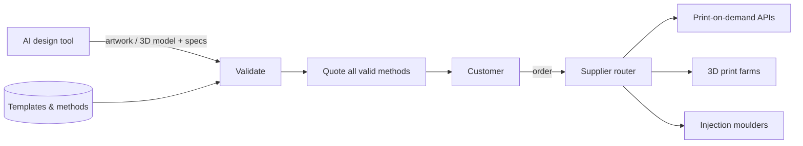

# Architecture — make-it-real

## 1. Scope
Turn AI-generated designs into manufacturable, priced orders.
**MVP:** product templates (print area / 3D), manufacturing methods with constraints and quantity
breaks, validators (DPI, aspect, colour count, wall thickness, build volume, MOQ), multi-method
quote with cheapest and fastest, production order.
**Product:** supplier network adapters, auto-fix (upscale, palette reduction, wall thickening), mockups, sampling.

## 2. System context

Supplier routing (Router → POD/farms/moulders) is roadmap, not shipped; this release quotes and validates only.

## 3. Validation rules
- **Print:** effective DPI = `px / inches` when fitted to the print area. Under 150 is an error,
  under 300 a warning. Aspect mismatch over 25% is a warning. Screen-print colour limits apply.
- **3D:** the part fits the build volume in *any orientation* (sorted dimensions are compared),
  and walls meet the method's minimum thickness.
- **Any method:** minimum order quantity.

## 4. Pricing
- **Print:** `template_base + method_unit × break(qty)`, plus setup.
- **3D:** `shell_volume_cm³ × method_rate × break(qty)` (hollow-shell approximation), plus setup,
  with a floor per unit.

## 5. Design decisions
- **Templates and methods as data.** Adding a product is configuration, not code.
- **Quote every method** and let the customer trade price against lead time. Cheapest and fastest are highlighted.
- **Orientation-agnostic fit check.** It avoids false rejections. *Trade-off:* it ignores support
  material and overhangs. Slicer integration is on the roadmap.

## 6. Future production architecture (not shipped)
A quote service (stateless), a supplier adapter layer (Printful/Printify APIs, Craftcloud-style
3D networks, RFQ email for moulders), an order state machine (`quoted → paid → in_production →
shipped`), and file storage for print-ready assets (PDF/X, STL/STEP). None of this is in this
release: the shipped product validates and quotes only; supplier routing is on the roadmap.

## 7. Risks
IP infringement in AI artwork, so trademark and logo screening is needed before production.
Supplier quality variance is handled with sample-first orders and supplier scorecards.

## 8. Limitations (sell-ready audit, 2026-10-28)
- No supplier ordering in this release: supplier adapters, the order state machine, and
  file storage for print-ready assets are roadmap (see §6). `production_order` (core.py:158)
  returns a dict for the buyer to send on; it is a Python API only, not a CLI or web output.
- No feature gating by plan: every API key unlocks the same software. Studio's former
  "production orders / custom supplier rates / team seats" claims were removed from sales
  copy; Fulfilment is a contact-sales human service, not a Stripe plan, and must not be
  added to `STRIPE_PRICES`.
- Stripe checkout now carries a 14-day trial for monthly plans
  (`subscription_data[trial_period_days]=14` in web.py), covered by
  tests/test_billing.py with a mocked Stripe call. Live Stripe prices and a live
  account were not verified in this run.
- Docker build and a live Render/Fly deployment were not verified in the audit
  environment (no Docker binary there); Dockerfile, render.yaml, and fly.toml are the
  same template shape as vibe-lube, but a deployment claim remains "not verified"
  until one is made.
- 3D pricing is a hollow-shell approximation (`shell_volume_cm³ × rate`), not a slicer
  quote, and the orientation-agnostic fit check ignores support material and overhangs.
